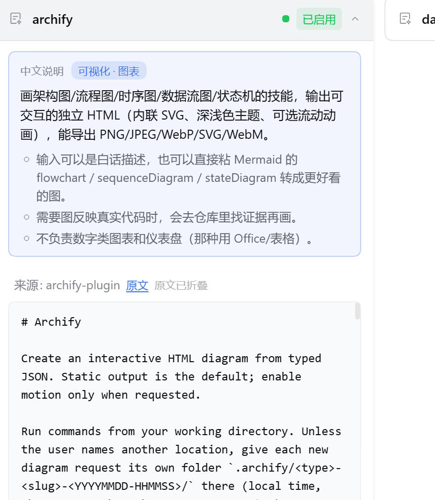

<div align="center">

# dsh-skill-zh-overlay

**给 [dsh-skill-mcp-panel](https://github.com/Fishquito7/dsh-skill-mcp-panel) 的技能卡片加一块中文说明浮层。**

展开技能卡片时，最上方显示中文速览 + 分类标签 + 要点列表；
面板原本那行英文原文自动折起，点「原文」再展开。

[](LICENSE)


</div>

## 效果

技能卡片展开后，中文说明渲染在原文上方：

<div align="center">

</div>

从上到下依次是：

1. **「中文说明」徽章 + 分类标签**（如 `可视化 · 图表`）
2. **一句话中文简介** —— 这个技能干什么
3. **要点列表** —— 什么时候该用它、有什么坑
4. **一条分隔线**
5. **来源 + 「原文」小按钮 + 「原文已折叠」提示** —— 原文不删，默认折起，点一下展开

三条原则：

- **不重复英文。** 面板下一行本来就写着原文，浮层不再抄一遍。
- **原文是中文的不加浮层。** `work-report-writer` 这类技能的描述本来就是中文，
  再叠一层中文只是把同一句话摆两遍，装饰脚本会按中文占比自动跳过。
- **没收录的什么都不加。** 不占位置、不显示「暂无说明」。

## 安装

```powershell
dsh plugin add dsh-skill-zh-overlay
```

**装完重启一次 dsh 即可**，不用再跑任何脚本 —— 装饰脚本由插件自己在启动时写好。

前置：已经装了 `dsh-skill-mcp-panel`。插件启动时会去找它的 `lib/client.js`；
如果还没装（或没放在能找到的位置），日志里会打印一行提示，中文块不生效，但
**不影响 dsh 和其他插件启动**。

从源码装（或想装在别的 profile）：

```powershell
git clone https://github.com/blacktaoK/dsh-skill-zh-overlay.git
cd dsh-skill-zh-overlay
pwsh -NoProfile -File install.ps1
```

`install.ps1` 做的事：

1. 把插件本体复制进一个 desktop generation 目录
   （`profiles\.generations\live\dsh-skill-zh-overlay+1.0.0+local0000000`）
2. 在 profile 的 `package.json` 里登记四处，让它出现在**插件市场的「已安装」列表**里：
   - `dependencies` —— 市场的 `readInstalled()` 读这里
   - `pnpm.overrides` —— `link:` 指向 generation
   - `dsh.profile.bundles[]` —— **在列表里 = 启用，移除 = 停用**
   - `dsh.desktop.generationProjection` —— desktop 的版本投影
3. 同步 `.generations\desired.json`

其他命令：

```powershell
pwsh -NoProfile -File install.ps1 -Check     # 看当前装了没有
pwsh -NoProfile -File install.ps1 -Revert    # 完整还原（含撤掉前端补丁）
```

> 用 `dsh plugin add` 装的时候就**不用**跑 `install.ps1` —— 这是 `dsh plugin add`
> 的包，loader 会把它登记进 bundles。`install.ps1` 是「从工作区源码装」的路径。

## 为什么做这个

`dsh-skill-mcp-panel` 的技能卡片直接透传各 `SKILL.md` 里的 `description`，
而这些描述几乎全是英文。像 `hindsight-coding-agent` 那种一段话讲完的长描述，
英文读起来慢，读完还不一定记住「这东西什么时候会自己跳出来」。

面板本身**没有任何 description 的中文字典**——它只负责把 frontmatter 原样贴出来。
所以这里做了一层外挂的中文说明，把「这个技能是干什么的」压成一眼能扫的形式。

## 它由两半组成

这个功能不是单个文件，而是**一个宿主插件 + 一处前端补丁**：

| 组成 | 位置 | 干什么 |
| --- | --- | --- |
| **宿主插件** `dsh-skill-zh-overlay` | 作为 bundle 挂进 profile | ① 读映射表注入 `window.__SKILL_ZH_MAP__`；② 启动时给面板 `client.js` 装装饰脚本 |
| **前端补丁** `lib/patch.fragment.js` | 由插件自动插进 `dsh-skill-mcp-panel/lib/client.js` | 读那个全局常量，在卡片展开区渲染中文块 |

为什么要拆成两半，各自的原因都挺硬的：

**为什么必须改 `client.js` 本体。**
面板的前端束是**打包产物**，没有留给外部插件的渲染扩展点。这不是偷懒，
是当下唯一能插进去的位置。所以装饰脚本只能以「在 factory 顶部注入一段自包含代码」
的方式落地，由宿主插件在启动时自动完成。

**为什么数据走 index 注入，不走 HTTP 路由。**
`/plugins` 是 client-modules 的前缀路由，**未知路径一律 404**
（`@deepseek-ai/dsh-client-modules/lib/index.js:977` 的 `bundleResource`，
未知资源返回 `{status:404}`，见 `lib/index.js:990`），
所以自定义 json 放在那里前端根本 fetch 不到。

## 仓库结构

```
dsh-skill-zh-overlay/
├── package.json           插件清单（含 dsh.bundle.patch 指向 cordis.patch.yml）
├── cordis.patch.yml       插件自己的 loader patch：把自己 insert 进来
├── install.ps1            从源码安装的转发入口
├── lib/
│   ├── index.js           宿主侧：读映射表 → 注册 index 注入行 → 启动时补面板
│   ├── installer.js       前端补丁的安装/还原实现（幂等、带备份、语法自检）
│   └── patch.fragment.js  注入到面板 client.js 的那段装饰脚本
├── data/
│   └── skill-zh-map.json  ★ 中文映射表，日常只改这个
├── tools/
│   └── apply.ps1          从源码装的安装器（安装 / -Check / -Revert）
├── test/
│   ├── test-installer.mjs 30 条隔离单测（不碰真机）
│   └── smoke.mjs          真机冒烟：确认装饰脚本确实进了面板束
└── assets/                README 用的截图
```

## 改中文说明

只需要动 `data/skill-zh-map.json`，然后**重启 dsh**（映射表在插件启动时读一次）。

### 映射表格式

```json
{
  "_readme": "以 _ 开头的键是注释，会被忽略",

  "技能名": {
    "zh": "一句话中文简介，显示在卡片展开区最上方。",
    "tag": "分类标签，显示为小徽章",
    "bullets": ["要点一", "要点二（2-4 条，讲清什么时候用 / 有什么坑）"],
    "noOverlay": "可选；true = 强制不加浮层"
  }
}
```

`技能名` 必须和卡片上的技能名完全一致（也是面板写在 DOM 上的 `data-skill-name`）。

**没收录的不会报错，也不会显示「暂无中文说明」** —— 就是不加，卡片保持面板原样。
原文本身已经是中文的技能，就算写进映射表也会被跳过（中文字符占比 ≥ 30% 即判定为中文原文）。

### 已收录

只收录**原文是英文**的技能（共 9 个）：

| 技能 | 分类 |
| --- | --- |
| `archify` | 可视化 · 图表 |
| `diagnose-windows-sandbox-acl` | 系统 · 排障 |
| `dsh-ppt` | Office · 演示 |
| `generate-image` | 图像生成 |
| `hindsight-coding-agent` | 记忆 · 知识库 |
| `office-docx` | Office · Word |
| `office-pptx` | Office · PPT |
| `office-xlsx` | Office · Excel |
| `reverse-engineer-anything` | 逆向工程 |

原文本来就是中文的 7 个（`data-viz-gen`、`dataset-health-audit`、`gov-doc-writing`、
`meeting-recap`、`research-writer`、`saas-metrics-coach`、`work-report-writer`）
**故意不写进映射表** —— 写了也会被跳过，不如不写，免得后来的人以为漏了。

## 原理

```
宿主插件 lib/index.js（apply 时做两件事）
   │
   ├─ ① 注册 webserver/index-inject 回调
   │     <profile> 渲染 index.html 时推入一行
   │     { kind: 'global', name: '__SKILL_ZH_MAP__', value: {...} }
   │     → <head><script>globalThis["__SKILL_ZH_MAP__"] = {...}</script></head>
   │
   └─ ② 找 dsh-skill-mcp-panel 的 lib/client.js，把装饰脚本写进去
         （幂等：已装就跳过；改过就先还原再重打）
            │
            ▼
lib/patch.fragment.js（在面板 client.js 的 factory 里执行）
   │  MutationObserver 盯 [data-skill-name] 卡片
   │  找到展开区 .SKV_cardDetails 里的 p.SKV_meta（面板渲染的原文行）
   ▼
① 原文是中文 / 没收录 → 什么都不做
② 否则：中文块 insertBefore 到原文行前面，再把原文行折成
   「来源: xxx + 原文按钮」，点按钮展开
```

**第 ② 步怎么找到面板。** 插件是 junction 安装的，Node 解析模块时给的是
**真实路径**（落在 `profiles/.generations/<gen>/node_modules/...`），而面板装在
`profiles/<profile>/node_modules/`。所以 `lib/installer.js` 从自身真实路径**往上走
到 `profiles/`**，再把它的每个子目录下的 `node_modules/dsh-skill-mcp-panel/...`
全列出来当候选 —— 这样无论插件在哪个 generation、哪个 profile 都能找到面板。

关键锚点（面板 v2.1.5）：

- 卡片根节点带 `data-skill-name`（`lib/client.js:1569`）
- 展开了才有 `.SKV_cardDetails`，其下 `p.SKV_meta` 是英文原文 + `来源: xxx`（`lib/client.js:1604-1609`）
- 补丁插入点在 `factory: (require) => {` 之后（`lib/client.js:3`）

面板是**手风琴**：同时只有一张卡展开。点另一张会把当前这张折叠、
`.SKV_cardDetails` 整个销毁；点回来会重建，补丁靠 `MutationObserver`
+ 点击后补跑（50/150/400ms）重新插入，所以来回切也不会丢。

## 本地自测

```powershell
node test/test-installer.mjs   # 30 条隔离单测，在临时目录里演练，不碰真机
node test/smoke.mjs            # 真机冒烟：装饰脚本是否确实进了面板束
```

`test-installer.mjs` 覆盖：锚点定位、幂等、重复安装不叠加、`-Revert` 还原、
面板升级后锚点缺失时不写坏文件、越界保护等。

它需要一份「未打过补丁」的前端束当载荷，按这个顺序找：

1. 本机面板的 `lib/client.js.skvzh.bak`（首次注入前的备份）
2. 本机面板的 `lib/client.js`（没有备份 = 从未注入过）
3. 都拿不到就用**内置的最小桩**（只保留真实锚点行，215 字节）

所以测试在没装面板的机器上也能跑，不用把一个 200KB 的上游产物固化进仓库。
面板装在非默认 profile 时，用 `DSH_PROFILE_DIR` 指过去。

## 已知限制

- **面板插件升级会覆盖 `client.js`**，补丁丢失、中文块消失。
  重跑一次插件（或重启 dsh）就会自动补回；原始文件备份在
  `lib/client.js.skvzh.bak`，`-Revert` 用它还原。
- 面板改版后 `data-skill-name` / `.SKV_cardDetails` / `.SKV_meta` 这些锚点可能变，
  补丁会静默失效（整体包在 try/catch 里，不影响面板本身）。届时对着新版 `client.js`
  调整 `lib/patch.fragment.js` 里的选择器。
- 映射表要**手工维护**，不会自动翻译：`SKILL.md` 里的 description 是英文的，
  没有本地翻译环节。
- 「原文」按钮折叠的是**面板自己的**那行描述文字，只改显示不改数据；
  React 重建子树后会重新装饰，装饰时按 `data-skvzh-open` 对齐按钮文案，
  不会把你手动展开的原文又收回去。
- 卡片是手风琴，点另一张会把当前这张折叠、`.SKV_cardDetails` 整个销毁；
  再点回来时补丁会重新插入，中文块和「原文」按钮都会回来。
- 位置靠后的「来源: dsh-office」是面板自己渲染的，不属于本项目。

## License

MIT
